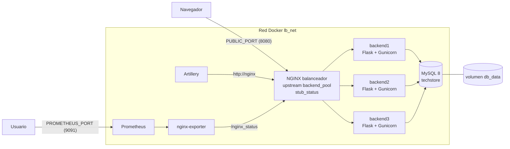

# Balanceador de carga web con NGINX: TecnoStore

Proyecto final de **Servicios Telemáticos** (Universidad Autónoma de Occidente, 2026-02).

NGINX funciona como **proxy inverso y balanceador de carga** delante de tres réplicas de una tienda en línea, **TecnoStore**, que consultan una base de datos **MySQL**. Todo se despliega con **Docker Compose**. El proyecto compara los algoritmos **round-robin, least_conn e ip_hash** con pruebas de carga en **Artillery**, mide en tiempo real con `stub_status` y **Prometheus**, y prueba qué pasa cuando un backend falla.

**Integrantes:** _(completar con nombre y código)_

> **Para ejecutarlo rápido:** instalar VirtualBox y Vagrant, y seguir la [sección 5](#5-despliegue-paso-a-paso). En resumen: `cd vagrant`, `vagrant up`, `vagrant ssh`, `cd ~/lb-nginx-tecnostore`, `docker compose -f docker-compose.yml up -d --build`, y abrir http://192.168.100.10:8080

---

## 1. Arquitectura



```
                     Host: puerto PUBLIC_PORT (8080)
                                  │
   ┌──────────────────────────────▼───────────────────────────────┐
   │  Red Docker "lb_net"                                         │
   │                 ┌──────────────────────────┐                 │
   │   Artillery ───►│  NGINX (lb-nginx)        │◄── nginx-exporter ◄── Prometheus ──► host :9091
   │                 │  upstream backend_pool   │                 │
   │                 └────┬─────────┬─────────┬─┘                 │
   │                      ▼         ▼         ▼                   │
   │                 backend1  backend2  backend3   (TecnoStore)  │
   │                      └─────────┼─────────┘                   │
   │                                ▼                             │
   │                       MySQL 8 (lb-mysql) ── volumen db_data  │
   │       (backends y base de datos sin puertos en el host)      │
   └──────────────────────────────────────────────────────────────┘
```

| Servicio | Imagen | Función | Puerto en el host |
|---|---|---|---|
| `nginx` | `nginx:1.28-alpine` | Balanceador y proxy inverso | `PUBLIC_PORT` (8080) |
| `backend1..3` | `lb-nginx-backend:2.0` (construida desde `backend/`) | Tienda TecnoStore (Flask + Gunicorn) | Ninguno |
| `db` | `mysql:8.0` | Catálogo, carritos y pedidos | Ninguno |
| `artillery` | `artilleryio/artillery` | Pruebas de carga (perfil `test`) | Ninguno |
| `nginx-exporter` | `nginx/nginx-prometheus-exporter` | Convierte `stub_status` en métricas de Prometheus | Ninguno |
| `prometheus` | `prom/prometheus` | Guarda y grafica las métricas | `PROMETHEUS_PORT` (9091) |

Orden de arranque: primero `db` (espera a que MySQL responda), luego los tres backends (esperan a que `db` esté *healthy*) y al final NGINX (espera a que los tres backends estén *healthy*).

---

## 2. La aplicación: TecnoStore

Una tienda de tecnología con **500 productos en 8 categorías** (marcas y modelos ficticios). Las tres réplicas ejecutan el mismo código y comparten la misma base de datos. Cada página lleva en la esquina inferior derecha una etiqueta **"Atendido por backendN · algoritmo"** para ver el balanceo desde el navegador.

### Páginas

| Ruta | Qué hace | Consulta a la base de datos |
|---|---|---|
| `/` | Catálogo con buscador, filtro por categoría, orden (relevancia, precio, nombre) y paginación de 24 | `SELECT` con `LIKE`, `ORDER BY`, `LIMIT/OFFSET` y `COUNT` |
| `/producto/<id>` | Detalle del producto y 4 productos relacionados | `SELECT` por id y por categoría |
| `/carrito` | Carrito del comprador | Lee `carrito_items` (o la memoria del backend) |
| `POST /carrito/agregar` y `/carrito/quitar` | Modifican el carrito | `INSERT ... ON DUPLICATE KEY UPDATE` / `DELETE` |
| `POST /checkout` | Compra: descuenta inventario y crea el pedido en **una sola transacción** | `UPDATE productos SET stock = stock - q WHERE stock >= q`, `INSERT` en `pedidos` y `pedido_items` |
| `/pedido/<id>` | Comprobante, con el backend que procesó la compra | `SELECT` con `JOIN` |
| `/pedidos` | Últimos 25 pedidos y **pedidos y ventas agrupados por backend** | `GROUP BY backend` |
| `/cluster` | **Estado del clúster** en vivo (ver abajo) | No |

Después de un `POST`, la aplicación responde con **303 See Other** (patrón Post/Redirect/Get), para que recargar la página no repita la compra.

### API JSON

| Ruta | Respuesta |
|---|---|
| `/api/productos?q=&categoria=&limite=` | Lista de productos (máximo 50) |
| `/api/productos/<id>` | Un producto |
| `/api/carrito` | `{backend, modo, unidades, items}` del comprador actual |
| `/stats` | Peticiones atendidas por este backend |
| `/api/cluster` | Peticiones de los tres backends y cuáles están activos |
| `/health` | `200` si el backend y la base de datos responden, `503` si la base de datos cayó (lo usa el healthcheck de Docker) |

### Página "Estado del clúster"

`/cluster` se actualiza cada 2 segundos. El backend que atiende la consulta le pide `/stats` a los otros dos por la red interna (`http://backendN:8080/stats`) y junta las respuestas. Muestra una barra y un porcentaje por backend, el algoritmo activo, el total de peticiones y si cada backend está **activo** o **caído**. Es la vista para la demostración: con round-robin las tres barras crecen igual, con ip_hash crece una sola, y en la prueba de resiliencia `backend2` aparece caído y vuelve.

### Dónde se guarda el carrito (`CART_STORAGE`)

El comprador se identifica con una cookie `carrito` (un UUID). El carrito puede guardarse de dos formas:

- **`db` (por defecto):** en la tabla `carrito_items`. Cualquier backend ve el mismo carrito, así que funciona con cualquier algoritmo.
- **`memory`:** en la memoria del backend que atendió. Si la siguiente petición cae en otro backend, el carrito aparece vacío. Solo funciona con **ip_hash**, que manda siempre al mismo cliente al mismo backend (afinidad de sesión).

La prueba `scripts/prueba_sesion.sh` mide esto (sección 7.5). Por eso cada backend corre Gunicorn con **1 proceso y 32 hilos**: así cada backend tiene una sola memoria y el modo `memory` se comporta como un servidor real.

### Base de datos

`db/init.sql` se ejecuta solo la primera vez que arranca MySQL (cuando el volumen `db_data` está vacío). Lo genera `db/generar_datos.py` con una semilla fija, así que siempre produce los mismos productos.

| Tabla | Contenido |
|---|---|
| `categorias` | 8 categorías |
| `productos` | 500 productos, precio en COP, stock inicial 5000, calificación |
| `carrito_items` | Carritos (modo `db`) |
| `pedidos` | Pedidos, con el **backend** que los procesó |
| `pedido_items` | Detalle de cada pedido |

Para borrar los datos y volver a crear la base desde cero: `docker compose down -v` (o `make reset-db`).

---

## 3. Estructura del repositorio

```
.
├── docker-compose.yml           # Todos los servicios
├── docker-compose.override.yml  # Entorno de desarrollo (recarga en caliente)
├── .env                         # Parámetros: algoritmo, workers, puertos, base de datos
├── Makefile                     # Atajos de comandos
├── backend/
│   ├── Dockerfile               # python:3.12-slim + Gunicorn
│   ├── requirements.txt
│   ├── app.py                   # Aplicación TecnoStore (Flask + SQLAlchemy)
│   └── templates/               # Páginas HTML (catálogo, producto, carrito, pedidos, clúster)
├── db/
│   ├── generar_datos.py         # Genera init.sql
│   └── init.sql                 # Esquema y 500 productos
├── nginx/
│   ├── nginx.conf               # Configuración del balanceador (montada como volumen)
│   ├── upstreams/               # Un bloque upstream por algoritmo
│   │   ├── round_robin.conf
│   │   ├── least_conn.conf
│   │   └── ip_hash.conf
│   └── hot-reload.sh            # Recarga en caliente (solo desarrollo)
├── artillery/
│   ├── rampa.yml                # Ramp-up progresivo
│   ├── carga-1000.yml           # 1000 compradores concurrentes durante ~60 s
│   └── resiliencia.yml          # Carga constante para la prueba de fallo
├── prometheus/prometheus.yml
├── scripts/                     # Automatización de pruebas y análisis
├── logs/nginx/                  # access.log y error.log del balanceador
├── results/                     # Resultados de las pruebas (no se suben a Git)
└── vagrant/Vagrantfile          # VM opcional con Docker preinstalado
```

---

## 4. Requisitos

Hay dos formas de ejecutar el proyecto. Se recomienda la **opción A**, que funciona igual en Windows, macOS o Linux y no requiere instalar Docker en el equipo.

| | Opción A: con Vagrant (recomendada) | Opción B: Docker directo |
|---|---|---|
| Para quién | Cualquier PC (así se desarrolló, en Windows) | Un Linux que ya tenga Docker |
| Programas | [VirtualBox](https://www.virtualbox.org/), [Vagrant](https://developer.hashicorp.com/vagrant/install) y Git | Docker Engine, Docker Compose v2, `python3`, `curl` |
| Memoria | 8 GB de RAM como mínimo (la VM usa 4 GB); 16 GB para las pruebas de 1000 usuarios | 4 GB libres |
| Disco | Unos 15 GB libres | Unos 3 GB libres |

`vagrant/Vagrantfile` crea una VM Ubuntu 22.04 (IP `192.168.100.10`, 4 GB de RAM, 2 CPU) con Docker, Compose y `make` ya instalados, y comparte con ella la carpeta del proyecto.

---

## 5. Despliegue paso a paso

### Opción A: con Vagrant (recomendada)

**Paso 1. Descargar el proyecto.** En una terminal del equipo (PowerShell en Windows):

```bash
git clone [<URL-del-repositorio>](https://github.com/ERSAgit/lb-nginx-tecnostore.git) lb-nginx-tecnostore
cd lb-nginx-tecnostore/vagrant
```

**Paso 2. Crear la VM y entrar a ella.**

```bash
vagrant up      # la primera vez tarda varios minutos: descarga Ubuntu e instala Docker
vagrant ssh     # abre una terminal dentro de la VM
```

**Paso 3. Dentro de la VM, levantar los contenedores.**

```bash
cd ~/lb-nginx-tecnostore
docker compose -f docker-compose.yml up -d --build    # o: make up
docker compose -f docker-compose.yml ps               # repetir hasta que todos salgan "healthy"
```

La primera vez se descargan las imágenes (unos minutos) y MySQL tarda entre 30 y 60 segundos en cargar los 500 productos. Los backends y NGINX esperan solos a que la base de datos esté lista. Al final, `ps` debe mostrar `db`, `backend1`, `backend2`, `backend3` y `nginx` como **healthy**, y `nginx-exporter` y `prometheus` como **Up**.

**Paso 4. Abrir en el navegador del equipo** (no hace falta entrar a la VM para esto):

| URL | Qué muestra |
|---|---|
| http://192.168.100.10:8080/ | La tienda. La etiqueta de abajo a la derecha dice qué backend respondió; al recargar cambia |
| http://192.168.100.10:8080/cluster | Estado del clúster en vivo |
| http://192.168.100.10:8080/pedidos | Pedidos y ventas por backend (después de hacer una compra) |
| http://192.168.100.10:8080/nginx_status | Métricas de NGINX (`stub_status`) |
| http://192.168.100.10:9091 | Prometheus (consultar por ejemplo `nginx_http_requests_total`) |

**Paso 5. Apagar.**

```bash
docker compose down     # dentro de la VM: detiene los contenedores (los datos se conservan en el volumen db_data)
exit                    # sale de la VM
vagrant halt            # en el equipo: apaga la VM
```

Para volver a usarlo: `vagrant up`, `vagrant ssh`, `cd ~/lb-nginx-tecnostore` y `docker compose -f docker-compose.yml up -d` (ya no hace falta `--build`). Para borrar la VM por completo: `vagrant destroy`.

**Si el equipo tiene poca RAM:** en `vagrant/Vagrantfile` cambiar `vb.memory = 4096` por `3072` y ejecutar `vagrant reload`. Alcanza para revisar la tienda, pero no para las pruebas de 1000 usuarios.

### Opción B: en un Linux que ya tiene Docker

```bash
git clone [<URL-del-repositorio>](https://github.com/ERSAgit/lb-nginx-tecnostore.git) lb-nginx-tecnostore
cd lb-nginx-tecnostore
docker compose -f docker-compose.yml up -d --build
docker compose -f docker-compose.yml ps
```

Las URL son las mismas de la tabla anterior, cambiando `192.168.100.10` por `localhost` (o por la IP de ese equipo). Apagar con `docker compose down`.

### Qué revisar para comprobar que funciona

1. Abrir la tienda y recargar varias veces: la etiqueta "Atendido por" cambia entre backend1, backend2 y backend3.
2. Buscar un producto, agregarlo al carrito y comprar. El comprobante dice qué backend procesó la compra, y el pedido aparece en `/pedidos`.
3. Abrir `/cluster`: las tres barras crecen de forma pareja con round-robin.
4. Cambiar de algoritmo (sección 6) y repetir: con `ip_hash` todas las páginas las atiende el mismo backend.

Todos los comandos de las secciones 6, 8 y 10 se ejecutan **dentro de la VM**, en la carpeta `~/lb-nginx-tecnostore`.

---

## 6. Parametrización con `.env`

| Variable | Valor por defecto | Uso |
|---|---|---|
| `BALANCE_POLICY` | `round_robin` | `round_robin`, `least_conn` o `ip_hash`. Elige qué archivo de `nginx/upstreams/` se monta |
| `NGINX_WORKERS` | `2` | Se pasa a NGINX con `-g "worker_processes ..."` |
| `PUBLIC_PORT` | `8080` | Puerto público del balanceador |
| `PROMETHEUS_PORT` | `9091` | Interfaz web de Prometheus |
| `CART_STORAGE` | `db` | `db` o `memory` (sección 2) |
| `GUNICORN_THREADS` | `32` | Hilos por backend |
| `DB_POOL_SIZE` | `10` | Conexiones a MySQL que mantiene abiertas cada backend |
| `MYSQL_*` | | Credenciales de la base de datos (solo para el laboratorio) |

Cambiar de algoritmo:

```bash
bash scripts/cambiar_politica.sh least_conn     # o: make politica P=least_conn
```

El script actualiza `.env`, recrea solo el contenedor de NGINX y comprueba la cabecera `X-Balance-Policy` que devuelve el balanceador.

---

## 7. Configuración de NGINX

- **`upstream backend_pool`** con los tres backends. Cada algoritmo está en su propio archivo:
  - `round_robin.conf`: sin directiva (es el comportamiento por defecto).
  - `least_conn.conf`: `least_conn;`
  - `ip_hash.conf`: `ip_hash;`
- **Detección de fallos:** `max_fails=3 fail_timeout=10s` en cada servidor.
- **Tiempos de espera:** `proxy_connect_timeout 2s`, `proxy_send_timeout 5s`, `proxy_read_timeout 5s`.
- **Reintentos:** `proxy_next_upstream error timeout http_502 http_503 http_504`, con `proxy_next_upstream_tries 3` y `proxy_next_upstream_timeout 10s`.
- **Conexiones persistentes** hacia los backends: HTTP/1.1, `keepalive 64` y `keepalive_timeout 60s`.
- **`stub_status`** en `/nginx_status`.
- **Log personalizado** (`log_format balanceo`): backend que respondió, dirección del upstream, código y tiempos.
- **Cabeceras:** `X-Backend`, `X-Upstream` y `X-Balance-Policy`. NGINX también le pasa al backend el algoritmo activo (`X-Balance-Policy`) para mostrarlo en las páginas.

### Lección aprendida: keep-alive de NGINX y Gunicorn

En las primeras pruebas, **least_conn dio 5 % de errores 502**. El `error.log` mostraba `upstream prematurely closed connection` y luego miles de `no live upstreams`. La causa: Gunicorn cerraba las conexiones inactivas a los **2 segundos** (su valor por defecto), mientras NGINX las guardaba **60 segundos** para reutilizarlas. NGINX enviaba peticiones por conexiones que el backend ya había cerrado, cada fallo contaba para `max_fails`, y en plena carga los tres backends quedaron marcados como caídos al mismo tiempo.

La regla es que **el backend debe mantener las conexiones abiertas más tiempo que el proxy**. Se configuró Gunicorn con `--keep-alive 75` y NGINX con `keepalive_timeout 60s`. Con eso los tres algoritmos quedaron con 0 errores.

---

## 8. Pruebas

Todas usan el archivo base (`-f docker-compose.yml`), sin el override de desarrollo. Los resultados quedan en `results/`.

### 8.1 Funcionamiento de cada algoritmo

```bash
bash scripts/cambiar_politica.sh round_robin
for i in $(seq 9); do curl -s -o /dev/null -D - localhost:8080/ | grep -i x-backend; done
bash scripts/estado.sh
```

Repetir con `least_conn` e `ip_hash`, o abrir `/cluster` en el navegador. Para ver `stub_status` en vivo durante una prueba: `bash scripts/estado.sh -w`.

### 8.2 Ramp-up progresivo

```bash
make rampa
```

Fases: 30 s a 5 usuarios/s, 60 s subiendo de 5 a 60 usuarios/s y 30 s sostenidos a 60 usuarios/s. Cada usuario abre el catálogo, hace una búsqueda ordenada por precio, abre un producto al azar y lo agrega al carrito.

### 8.3 Comparación de algoritmos con 1000 compradores concurrentes

```bash
bash scripts/comparar_algoritmos.sh          # o: make comparar
```

Para cada algoritmo ejecuta `carga-1000.yml`: 1000 compradores virtuales que entran en 10 s. Cada uno abre el catálogo, visita 55 productos al azar (uno por segundo), agrega uno al carrito y compra. Son unas 60 000 peticiones y 1000 pedidos por algoritmo. Guarda:

- `results/<algoritmo>_carga.json`: resultados completos de Artillery
- `results/<algoritmo>_stub_antes.txt` y `_stub_despues.txt`: capturas de `stub_status`
- `results/<algoritmo>_distribucion.txt`: peticiones por backend según el log de NGINX
- `results/comparacion.md`: tabla con req/s, latencia media, p95, p99 y errores

En `/pedidos` se ve además cuántos pedidos procesó cada backend.

### 8.4 Resiliencia: eliminar un backend en caliente

```bash
bash scripts/cambiar_politica.sh round_robin
bash scripts/prueba_resiliencia.sh           # o: make resiliencia
```

Con carga constante de 90 s: a los 30 s elimina `backend2` (`docker compose rm -sf backend2`), a los 60 s lo vuelve a crear y recarga NGINX. Genera `results/resiliencia_linea_tiempo.txt`, con las peticiones de cada backend cada 10 s. Durante la prueba, `/cluster` muestra `backend2` como caído.

### 8.5 Sesión: ¿el carrito sobrevive al balanceo?

```bash
bash scripts/prueba_sesion.sh                # o: make sesion
```

Con el carrito en memoria y luego en la base de datos, y con cada algoritmo, simula 20 compradores que agregan 3 productos y revisan su carrito. Cuenta cuántos ven sus 3 productos. Al final deja otra vez `CART_STORAGE=db` y el algoritmo que estaba. Genera `results/sesion.md`.

### 8.6 Análisis de logs

```bash
bash scripts/analizar_logs.sh                # o: make distribucion
python3 scripts/linea_tiempo.py logs/nginx/access.log 10
```

Distribución real de peticiones por backend, códigos de estado, peticiones reintentadas en otro backend y peticiones por backend en intervalos de tiempo.

---

## 9. Resultados de referencia

Prueba de desarrollo en una máquina de 2 CPU, con los mismos componentes fuera de Docker (MySQL 8.0, 3 backends con Gunicorn, NGINX y Artillery 2). **Los valores cambian según el equipo**; la tabla del informe debe salir de una corrida completa en el entorno Docker.

**1000 compradores concurrentes (unas 60 000 peticiones y 1000 pedidos por algoritmo):**

| Algoritmo | Req/s | Media | p99 | Errores | Reparto |
|---|---|---|---|---|---|
| round_robin | 511 | 434 ms | 1300 ms | 0 | 33.33 % exacto para cada backend |
| least_conn | 513 | 438 ms | 1249 ms | 0 | entre 33.2 % y 33.4 % |
| ip_hash | 519 | 558 ms | 1620 ms | 0 | 100 % a un solo backend |

**Sesión (compradores que conservaron su carrito, de 20):**

| Carrito guardado en | round_robin | least_conn | ip_hash |
|---|---|---|---|
| memoria del backend | 0/20 | 0/20 | 20/20 |
| base de datos | 20/20 | 20/20 | 20/20 |

**Resiliencia (45 s a 50 peticiones/s, backend2 eliminado del segundo 12 al 27):** 2250 peticiones, **0 errores**, 8 peticiones reintentadas en otro backend. Mientras `backend2` estuvo caído, backend1 y backend3 se repartieron todo el tráfico, y al volver recibió otra vez un tercio.

```
segundos   backend1  backend2  backend3  errores
   5-10        84        83        83        0
  10-15       122         3       126        0     ← se elimina backend2
  15-20       125         0       125        0
  25-30       125         0       125        0
  30-35       101        49       100        0     ← backend2 vuelve
  35-40        83        84        83        0
```

Qué se espera de cada algoritmo:

- **round_robin:** reparto exacto en orden. Es el más simple y aquí funciona bien porque las tres réplicas son iguales.
- **least_conn:** reparto parecido, pero envía cada petición al backend con menos peticiones en curso. Su ventaja aparece cuando unas peticiones tardan más que otras (por ejemplo una compra frente a ver un producto): baja un poco el p99.
- **ip_hash:** **todo el tráfico de Artillery va a un solo backend**, porque todas las peticiones salen de la misma IP (la del contenedor de Artillery). Es el comportamiento correcto de la afinidad de sesión, y muestra su costo: con pocos clientes distintos no reparte la carga, y la latencia sube porque un backend hace el trabajo de tres. A cambio es el único que conserva un carrito guardado en memoria.
- **Resiliencia:** el servicio sigue respondiendo con un backend caído; las peticiones que iban a él se reintentan en otro.

---

## 10. Entorno de desarrollo con recarga en caliente

```bash
docker compose up -d --build              # aplica automáticamente docker-compose.override.yml
docker compose logs -f nginx
```

El override reemplaza el arranque de NGINX por `nginx/hot-reload.sh`, que revisa cada 2 s si cambió `nginx/nginx.conf` o el archivo del algoritmo activo. Si cambió, valida con `nginx -t` y recarga con `nginx -s reload`, sin cortar las conexiones activas. Si la configuración tiene errores, no recarga y lo informa en el log.

---

## 11. Decisiones técnicas y limitaciones

- **Configuración montada, no copiada:** `nginx.conf` y el archivo del algoritmo se montan como volúmenes de solo lectura. La imagen de NGINX es la oficial.
- **Solo NGINX expone un puerto de la aplicación:** backends y base de datos usan `expose`.
- **Base de datos compartida:** las tres réplicas leen y escriben la misma base. La compra usa una transacción con `stock >= q` en el `UPDATE`, para que dos compras simultáneas en backends distintos no dejen el inventario negativo.
- **Resolución de nombres:** NGINX resuelve `backend1..3` al arrancar. Si un backend se recrea con otra IP hay que recargar NGINX; el script de resiliencia lo hace.
- **ip_hash y Artillery:** como Artillery corre en un solo contenedor, todas sus peticiones tienen la misma IP de origen. Para repartir con ip_hash habría que generar carga desde varios clientes.
- **Recursos:** Artillery, NGINX, los backends y MySQL corren en la misma máquina y compiten por la CPU. Los resultados sirven para comparar algoritmos entre sí, no como la capacidad de un servidor dedicado.
- **Credenciales en `.env`:** son de laboratorio. En producción irían en *secrets* y no en el repositorio.

---

## 12. Cumplimiento de requisitos

| Requisito | Implementación |
|---|---|
| NGINX con upstream hacia mínimo 3 backends | `nginx/upstreams/*.conf`, servicios `backend1..3` |
| round-robin, least_conn e ip_hash | Un archivo por algoritmo, se elige con `BALANCE_POLICY` |
| stub_status | `location = /nginx_status` |
| Timeouts y reintentos | `proxy_*_timeout`, `proxy_next_upstream*`, `max_fails`, `fail_timeout` |
| Artillery con ramp-up progresivo | `artillery/rampa.yml` |
| Comparar rendimiento entre algoritmos | `scripts/comparar_algoritmos.sh` |
| Fallo de backends durante la prueba | `scripts/prueba_resiliencia.sh` |
| docker-compose.yml con NGINX, 3 backends y Artillery | `docker-compose.yml` (además MySQL, exporter y Prometheus) |
| nginx.conf montado como volumen | `./nginx/nginx.conf:/etc/nginx/nginx.conf:ro` |
| Red con nombre explícito, backends sin puertos en el host | Red `lb_net`, backends solo con `expose` |
| .env con workers, puerto público y política | `NGINX_WORKERS`, `PUBLIC_PORT`, `BALANCE_POLICY` |
| Prometheus + nginx-prometheus-exporter | Servicios `prometheus` y `nginx-exporter` |
| docker-compose.override.yml con recarga en caliente | `docker-compose.override.yml` + `nginx/hot-reload.sh` |
| README con diagrama, comandos y resultados esperados | Este archivo |
| Capturas de stub_status por algoritmo | `results/<algoritmo>_stub_*.txt` |
| Eliminar un backend en caliente | `scripts/prueba_resiliencia.sh` |
| 1000 usuarios concurrentes durante 60 s | `artillery/carga-1000.yml` |
| Latencia media y p99 por algoritmo | `results/comparacion.md` |
| Distribución real de peticiones según los logs | `scripts/analizar_logs.sh` |
| Backends con una aplicación real y base de datos | TecnoStore + MySQL (sección 2) |
| Efecto del algoritmo sobre la sesión del usuario | `scripts/prueba_sesion.sh` |
